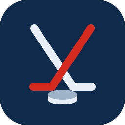
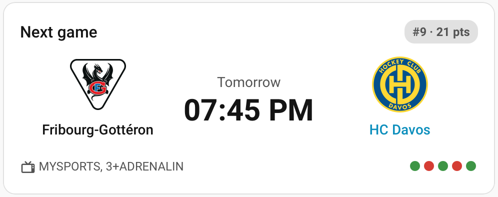
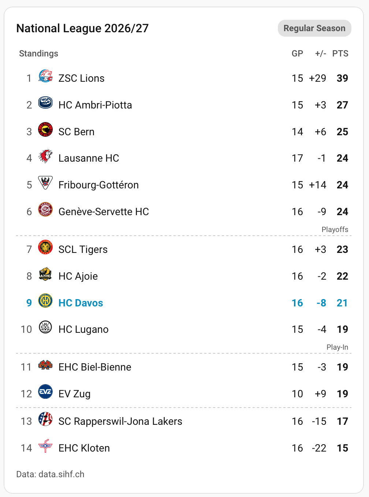
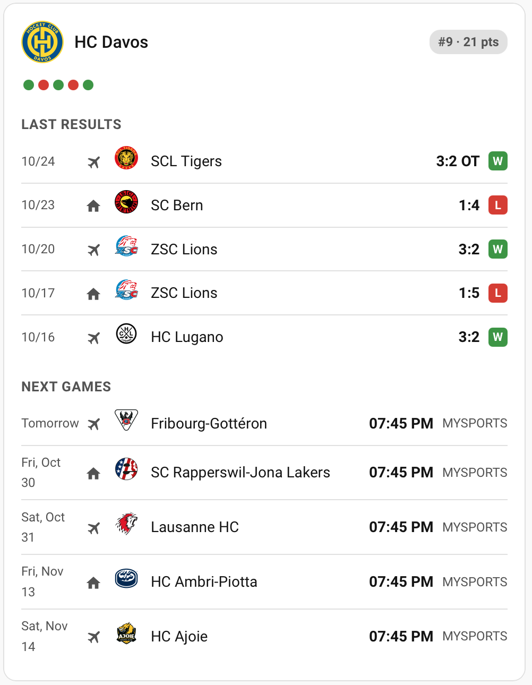

# Swiss Ice Hockey (National League) for Home Assistant

[](https://hacs.xyz/docs/faq/custom_repositories)

[](https://github.com/dukes4/ha-swiss-hockey/actions/workflows/validate.yml)

A Home Assistant integration for the Swiss **National League** (ice hockey): your favourite club's next game with live score, the league standings and a detail view for every club, as sensors and as three ready-made Lovelace cards.

> 🇩🇪 Deutsche Kurzanleitung weiter unten: [Auf Deutsch](#auf-deutsch)

---

## ⚠️ Data source – please read first

All data comes from **`data.sihf.ch`**, the statistics interface used by the Swiss Ice Hockey Federation (SIHF) for its own website.

- This interface is **not officially documented** and is **not a public API**. It can change or disappear at any time without notice. If that happens, the integration stops working until it is updated.
- This project is **not affiliated with, endorsed by or supported by** the SIHF, the National League or any club.
- Please do not report data errors to the SIHF – open an issue here instead.

**Playoffs and playouts:** we do not have any experience yet with how the playoff and playout series are delivered by the interface, because that data only becomes available in spring. The regular season works; the display of playoff and playout series is **being worked on**.

## Features

- **Setup in the UI** – no YAML needed:
  1. Consent to download the club logos (optional).
  2. Choose your favourite club from the current National League.
  Both can be changed later under *Configure*.
- **Sensors** for your favourite club
  - *Next game* – kick-off as timestamp; opponent, home/away, TV channel and, during the game, the live score as attributes
  - *Last game* – e.g. `SCB 4:1 HCD`
  - *Form* – the last five results, e.g. `WWLWW`
  - *Rank* and *Points* in the league table
- **Polling:** every 30 minutes, every 2 minutes from 10 minutes before face-off until the game is over. The interface itself caches its data for about 5 minutes.
- **Season and phase are detected automatically** – no manual change needed when a new season starts.
- **Three Lovelace cards**, installed and registered automatically together with the integration:

| Card | Type | Shows |
|---|---|---|
| Next game | `custom:swiss-hockey-next-game` | Next game of your favourite club, live score, form |
| Standings | `custom:swiss-hockey-standings` | League table, your club highlighted |
| Club | `custom:swiss-hockey-club` | Last results and next games of one club |

Tapping a club in the *Standings* or *Next game* card opens the club view as a pop-up.

## Screenshots

| Next game | Standings | Club (also as pop-up) |
|---|---|---|
|  |  |  |

<sub>Screenshots taken with logo consent enabled. The club logos are the property of the respective clubs; they are not part of this integration and are only downloaded to your own Home Assistant after your consent. Without consent the cards show the club abbreviation instead.</sub>

## Club logos

The integration does **not** contain any logos. If you give your consent during setup, the logos are downloaded once from `sihf.ch` and stored locally in your Home Assistant (`/config/www/swiss_hockey/logos`). They remain the property of the respective clubs and are only shown on your own dashboards. Without consent, the cards show the club abbreviation in a circle instead.

## Installation

### HACS (custom repository)

1. In Home Assistant open **HACS**.
2. Open the menu (⋮, top right) → **Custom repositories**.
3. Repository: `https://github.com/dukes4/ha-swiss-hockey`, type: **Integration** → **Add**.
4. Search for **Swiss Ice Hockey (National League)** in HACS and click **Download**.
5. **Restart** Home Assistant.
6. **Settings → Devices & services → Add integration →** *Swiss Ice Hockey*.

### Manual

Copy the folder `custom_components/swiss_hockey` into the `custom_components` folder of your Home Assistant configuration and restart Home Assistant.

## Cards

The cards are available in the card picker of the dashboard editor. YAML examples:

```yaml
type: custom:swiss-hockey-next-game
```

```yaml
type: custom:swiss-hockey-standings
```

```yaml
type: custom:swiss-hockey-club
team: HCD   # club abbreviation, e.g. HCD, ZSC, SCB
```

## Requirements

- Home Assistant (current version)
- Internet access from Home Assistant to `data.sihf.ch` (and to `sihf.ch` for the logos)

## Known limitations

- Playoff and playout series: see the note on the data source above.
- National League only. Swiss League, Champions Hockey League (CHL) and the national team are not included.
- The data is only as current as the SIHF interface; live scores can be delayed by a few minutes.

## Issues and contributions

Please report problems in the [issues](https://github.com/dukes4/ha-swiss-hockey/issues). Include your Home Assistant version and the relevant log lines (`custom_components.swiss_hockey`).

## License

[MIT](LICENSE)

---

## Auf Deutsch

**Swiss Ice Hockey (National League)** bringt die National League in Home Assistant: das nächste Spiel deines Lieblingsvereins mit Live-Stand, die Rangliste und eine Detailansicht für jeden Verein, als Sensoren und als drei fertige Lovelace-Karten.

### ⚠️ Datenquelle

Alle Daten stammen von **`data.sihf.ch`**, der Statistik-Schnittstelle, welche die Swiss Ice Hockey Federation (SIHF) für ihre eigene Webseite nutzt.

- Diese Schnittstelle ist **nicht offiziell dokumentiert** und **keine öffentliche API**. Sie kann sich jederzeit ohne Vorankündigung ändern oder wegfallen. Dann funktioniert die Integration bis zu einem Update nicht.
- Dieses Projekt steht in **keiner Verbindung** zur SIHF, zur National League oder zu einem Verein.
- Bitte Datenfehler nicht der SIHF melden, sondern hier ein Issue eröffnen.

**Playoffs und Playouts:** Mit der Darstellung der Playoff- und Playout-Serien haben wir noch keine Erfahrung, weil diese Daten erst im Frühling verfügbar sind. Die Qualifikation funktioniert; an der Darstellung der Playoffs und Playouts **wird gearbeitet**.

### Einrichtung

1. HACS → Menü (⋮) → **Benutzerdefinierte Repositories** → `https://github.com/dukes4/ha-swiss-hockey`, Typ **Integration**.
2. Integration in HACS herunterladen und Home Assistant **neu starten**.
3. **Einstellungen → Geräte & Dienste → Integration hinzufügen →** *Swiss Ice Hockey*.
4. Bei der Einrichtung gibst du frei, ob die Vereinslogos heruntergeladen werden dürfen, und wählst deinen Lieblingsverein. Beides lässt sich später unter *Konfigurieren* ändern.

### Screenshots

Die Bilder oben zeigen die Karten mit Logo-Freigabe. Die Logos sind Eigentum der Vereine und nicht Teil dieser Integration.

### Vereinslogos

Die Integration enthält **keine** Logos. Nur mit deiner Freigabe werden sie einmalig von `sihf.ch` geladen und lokal in deinem Home Assistant gespeichert. Sie bleiben Eigentum der Vereine und erscheinen nur auf deinen eigenen Dashboards. Ohne Freigabe zeigen die Karten das Vereinskürzel in einem Kreis.

### Karten

- `custom:swiss-hockey-next-game`: nächstes Spiel des Lieblingsvereins mit Live-Stand und Form
- `custom:swiss-hockey-standings`: Rangliste, dein Verein hervorgehoben
- `custom:swiss-hockey-club`: letzte Resultate und nächste Spiele eines Vereins

Ein Tipp auf einen Verein in der Rangliste oder auf der Spielkarte öffnet die Vereinsansicht als Popup.
